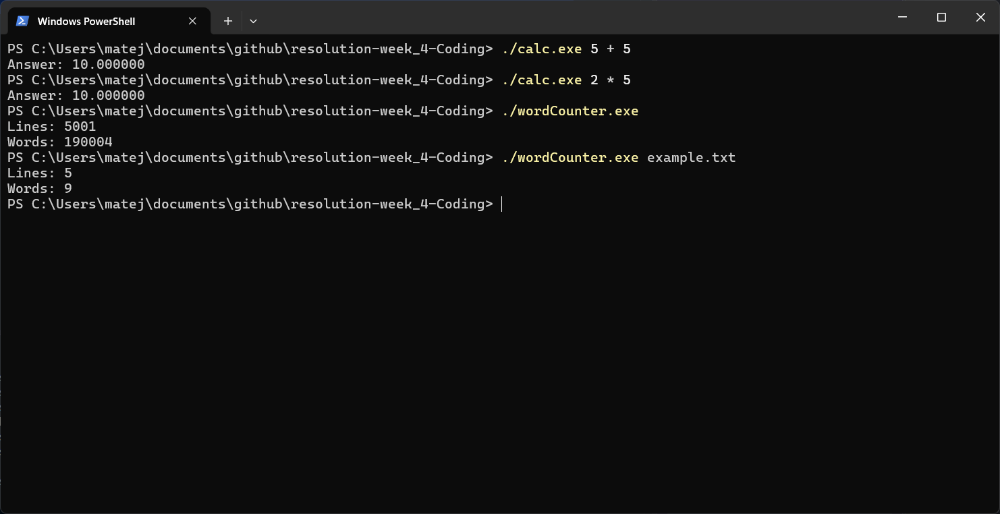

# Resolution-week_4-Coding

Small command-line tools written in C: a word counter and a basic calculator.
This project was created as a practical introduction to C and compiling programs
from the terminal.

## What it can do

### Word counter

- Counts the number of lines in a text file.
- Counts the words in that file.
- Uses `test.txt` by default.
- Accepts a different input file as a command-line argument.

### Calculator

- Performs addition, subtraction, multiplication, and division.
- Supports `+`, `-`, `*`, `/`, and `x` as operators.
- Accepts expressions as three command-line arguments: number, operator, number.

## Screenshots

The screenshot below shows both programs running in PowerShell:



## Requirements

- A C compiler, such as [GCC](https://gcc.gnu.org/).
- PowerShell or another terminal.
- Windows users can use the MSYS2/UCRT64 GCC installation configured in
  `.vscode/settings.json`.

## Build

From the project directory, create the `builds` directory if it does not exist
and compile both programs:

```powershell
New-Item -ItemType Directory -Force builds
gcc .\calc.c -o .\builds\calc.exe
gcc .\wordCounter.c -o .\builds\wordCounter.exe
```

The pre-built executables in the repository root and in `builds` can also be
used on compatible Windows systems, but compiling from source ensures that the
executables match your current code.

## Run

### Calculator

Pass a number, an operator, and another number:

```powershell
.\builds\calc.exe 5 + 5
.\builds\calc.exe 2 '*' 5
.\builds\calc.exe 10 / 4
```

Example output:

```text
Answer: 10.000000
```

### Word counter

Run without an argument to count `test.txt`:

```powershell
.\builds\wordCounter.exe
```

Pass a file path to count another text file:

```powershell
.\builds\wordCounter.exe .\example.txt
```

Example output:

```text
Lines: 5
Words: 9
```

## Running from VS Code

1. Open this folder in VS Code.
2. Make sure the C/C++ extension and GCC are installed.
3. Open either `calc.c` or `wordCounter.c`.
4. Use the build task from **Terminal > Run Build Task**.
5. Run the generated executable from the integrated terminal using the commands
   above.

